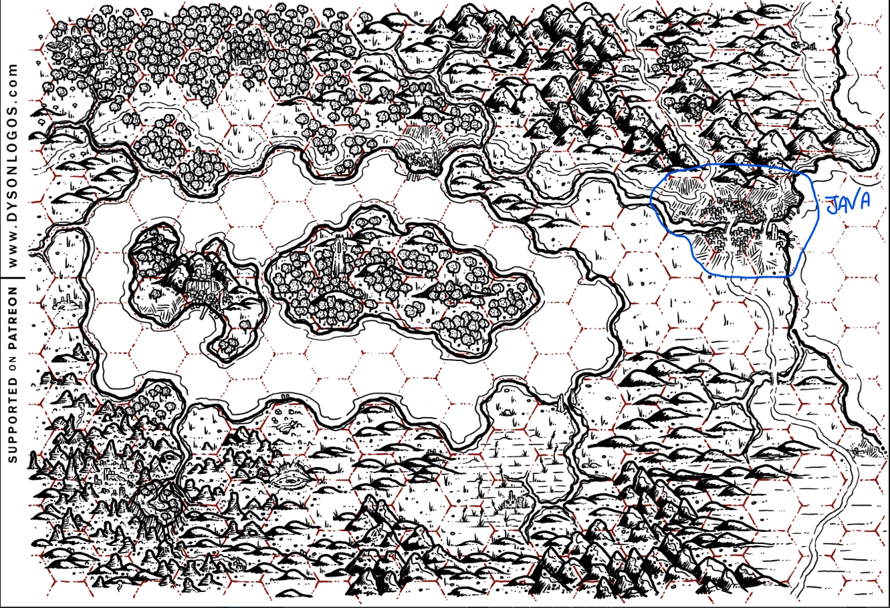

# Aethelgard

Guia dos jogadores. Sistema: Forja RPG. O mundo foi criado pelo grupo na primeira sessão, com a Ficha de Mundo.

## O Mundo

**Aethelgard.** O nome do mundo.

**Drayone.** O continente onde a campanha começa.

**Idiomas.** Os mais falados são os élficos e o Comum, a língua dos humanos.

**Altares divinos.** Todo mundo sabe: há altares dos deuses espalhados pelo mundo. Quem deixa uma oferenda num altar recebe uma bênção daquele deus, conforme a oferenda.

**A Grande Fenda.** O maior perigo de hoje. Uma fenda aberta para o reino dos demônios, por onde eles saem para o mundo.

## O Calendário

O Calendário de Aethelgard. O ano atual é **248**.

**Semana.** 7 dias.

**Mês.** 4 semanas, ou 28 dias. Tempo livre de 4 semanas dura um mês certo.

**Ano.** 12 meses, ou 336 dias. Cada mês lembra um mês nosso, na mesma ordem.

| Nº | Mês | Lembra |
|---|---|---|
| 1 | Janvar | janeiro |
| 2 | Fevrar | fevereiro |
| 3 | Marcion | março |
| 4 | Abrel | abril |
| 5 | Maiel | maio |
| 6 | Junar | junho |
| 7 | Julvar | julho |
| 8 | Agoston | agosto |
| 9 | Setember | setembro |
| 10 | Otubrin | outubro |
| 11 | November | novembro |
| 12 | Dezember | dezembro |

**Como escrever.** Dia, mês e ano: 8 de November de 248.

## Os Deuses

Por enquanto, o grupo criou uma só divindade. Todo sacerdote e paladino da campanha segue Woltander (veja Divindades).

## Woltander

Deus da justiça, da luz e do sol nascente.
{ .epigrafe }

**Entidade.** Deus da justiça.

**Tendência.** Bem e Ordem.

**Domínio.** Luz (radiante). Vantagem em testes para perceber o escondido e resistir a cegueira.

**Vínculo.** Devoção.

**Responsabilidades.** Nunca minta a uma autoridade justa. Abrigue quem pedir.

**Sagrados.** A espada, a águia e o nascer do sol.

**Símbolo.** Uma espada de ponta para baixo, cravada no horizonte, com o sol nascendo atrás do guarda-mão.

**Bênção menor (nível 1).** Sua espada brilha como uma tocha quando você quiser.

**Bênção maior (nível 5).** **Arma Sagrada.** Pessoal, 10 rodadas. Seus ataques com arma causam +1d6 de dano radiante. Custo 2.

**Milagre (nível 9).** **Exílio.** Perto, até três criaturas de outro plano, resistência (Carisma). Elas voltam para o plano de origem. Custo 9. Uma vez por descanso longo, sem gastar Mana.

**O que ele quer.** Acabar com uma linhagem inteira. Hoje, a linhagem de demônios que sai pela Grande Fenda, e com ela a própria Fenda.

**Como ele fala.** Quase nunca fala direto com alguém. Quando fala, é por um reflexo: na água, num espelho, numa lâmina polida.

## Java

A cidade inicial. Fica perto da costa e vive de exportar café.

**Quem manda.** O Barão de Java.

**Tamanho.** Java não é só uma cidade: é um complexo de fazendas de café com uma sede no meio, grande como uma capital. No mapa da região, ocupa uns 3 hexágonos.

**O problema.** Pessoas desaparecendo. Foi a primeira aventura (veja Diário).

**O Centro de Distribuição.** Para onde vai o café das fazendas antes de seguir para a costa. É do marido de Maren Dovel. Tonho trabalha lá.

**O moinho.** Destruído por uma explosão de farinha. Por baixo dele há passagens até as criptas da capela.

## A Região

Uma região de Drayone. Java fica no leste, perto da costa, cercada pelas fazendas de café.

{ .fj-arte loading=lazy }

Mapa de [Dyson Logos](https://dysonlogos.com).

## O Grupo

**Como se conheceram.** Nas fazendas de Java.

## Linha do Tempo

O que aconteceu em Aethelgard, em ordem. Inclui o que outras mesas fizeram no mesmo mundo.

| Data | O que aconteceu | Onde |
|---|---|---|
| 5 de November de 248 | O sino da capela toca sozinho pela primeira vez. | Java |
| 8 de November de 248 | O grupo cala o sino, mata os soldados drows e põe Velistra para correr. | Java |

## Diário

Uma entrada por sessão, com a data na mesa e a data em Aethelgard.

### Sessão 1: O Sino da Capela

**Na mesa.** 8 de novembro de 2026. Funil, nível 0.

**Em Aethelgard.** 8 de November de 248.

O sino da capela abandonada tocava sozinho, e quem ouvia sumia. O grupo investigou o vilarejo e foi ao Centro de Distribuição de café. Maren Dovel, esposa do dono, também tinha sumido. Os trabalhadores queriam tocar o negócio sozinhos, e houve discussão com Tonho. Nos escritórios, o grupo achou uma carta: Maren vendia os vizinhos aos drows em troca de ouro. Ela sumiu, e ninguém sabe onde está.

As pistas levaram ao moinho: era por ali que os desaparecidos eram levados. O moinho estava cheio de farinha, com uma armadilha pronta para fazer tudo explodir. O grupo detonou a explosão antes da hora, de longe. O moinho veio abaixo para dentro e matou os ratos que estavam lá.

Por um canal sob o moinho, o grupo chegou às criptas da capela e enfrentou esqueletos. Odo, o moleiro, atacou o grupo e morreu com uma flecha na cabeça. Só então se viu que um diabrete o possuía: a criatura saiu do corpo quando ele morreu. Na cripta maior estava a drow Velistra, com um algoz e depois soldados drows. Velistra fugiu muito ferida. O grupo matou os soldados.

Ali havia uma fenda que era um portal para a Treva, as cavernas sob o mundo. Os drows levavam os moradores de Java por ela para virar escravos.

**Espólio.** O que havia com os drows e nos depósitos, e os pagamentos que Maren recebia. Cada um anotou o seu na ficha.
