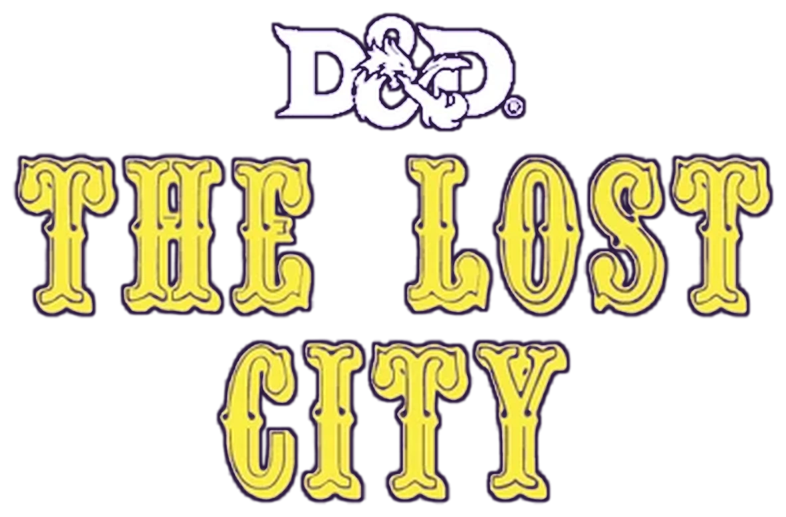
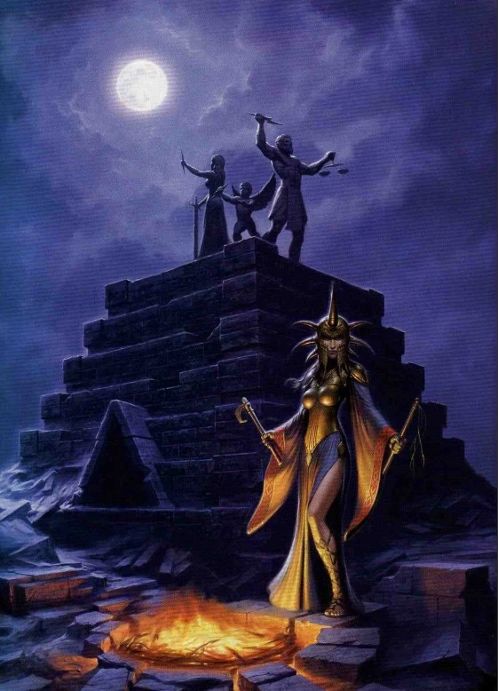
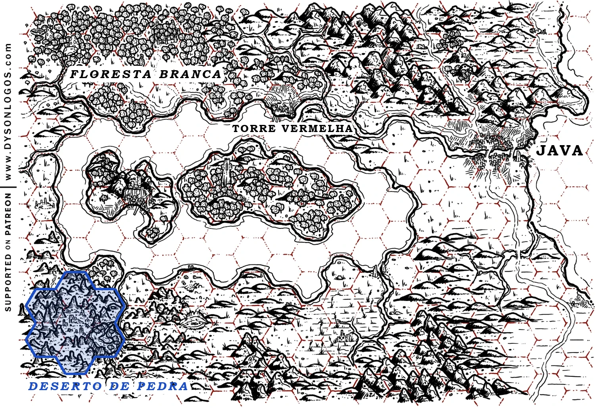
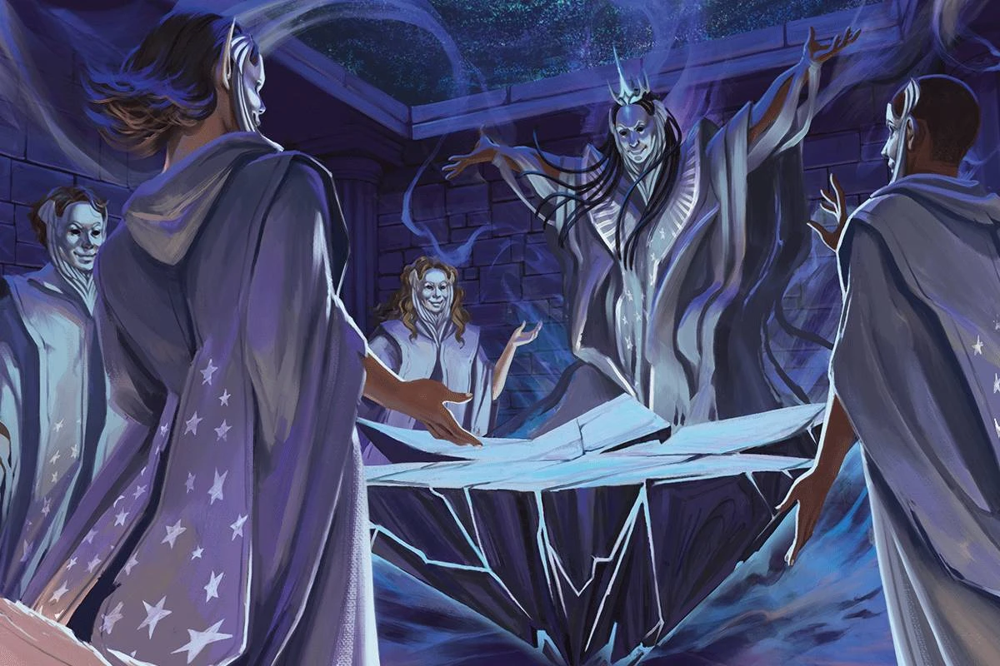

# A Cidade Perdida

{ .fj-arte .fj-arte-logo }

Um destino da campanha Aethelgard (veja Para Onde Agora? em [Aethelgard](aethelgard.md)).

## A Proposta

A sudoeste do lago, a terra seca e vira o Deserto de Pedra: rochedos, cânions e areia. Dizem que a areia engoliu uma cidade inteira. Só o topo de uma pirâmide de degraus aparece acima das dunas.

{ .fj-arte .fj-arte-retrato loading=lazy }

Primeiro, a viagem: atravessar a região, achar o caminho e sobreviver ao deserto. Depois, a pirâmide e o que houver embaixo dela.

## Como Chegar

O Deserto de Pedra fica a uns 14 hexágonos a sudoeste de Java, do outro lado do lago (veja Viagem). Ninguém em Java sabe o hexágono exato da pirâmide. Os boatos apontam para os hexágonos marcados em azul.

{ .fj-arte loading=lazy }

**Água.** O deserto tem pouca. Leve para a ida e para a volta.

## O Que Se Diz em Java

Boatos do porto e das fazendas. Alguns são verdade.

- Uma caravana cortou caminho pelo deserto. Uma tempestade de areia engoliu metade dela, e quem voltou jura que viu uma pirâmide.
- A cidade era rica e caiu numa só geração. Ninguém sabe por quê.
- Há luz nas frestas da pirâmide à noite.
- Os reis da cidade foram enterrados com o seu ouro, e com armadilhas para quem viesse buscá-lo.
- Os antigos de lá adoravam um deus que ninguém mais lembra. Talvez ele ainda se lembre deles.
- Bichos do deserto crescem demais por lá: escorpiões, besouros, lagartos.

{ .fj-arte loading=lazy }
