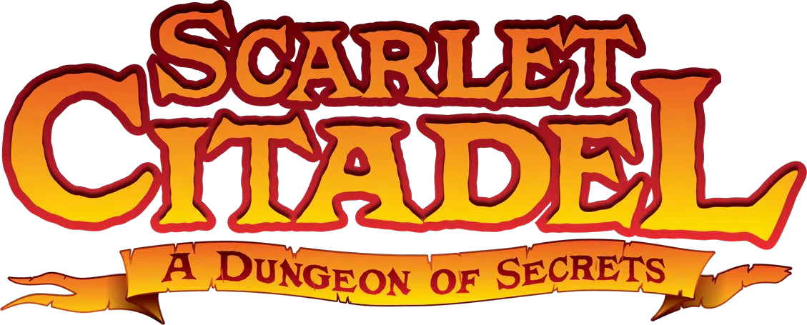
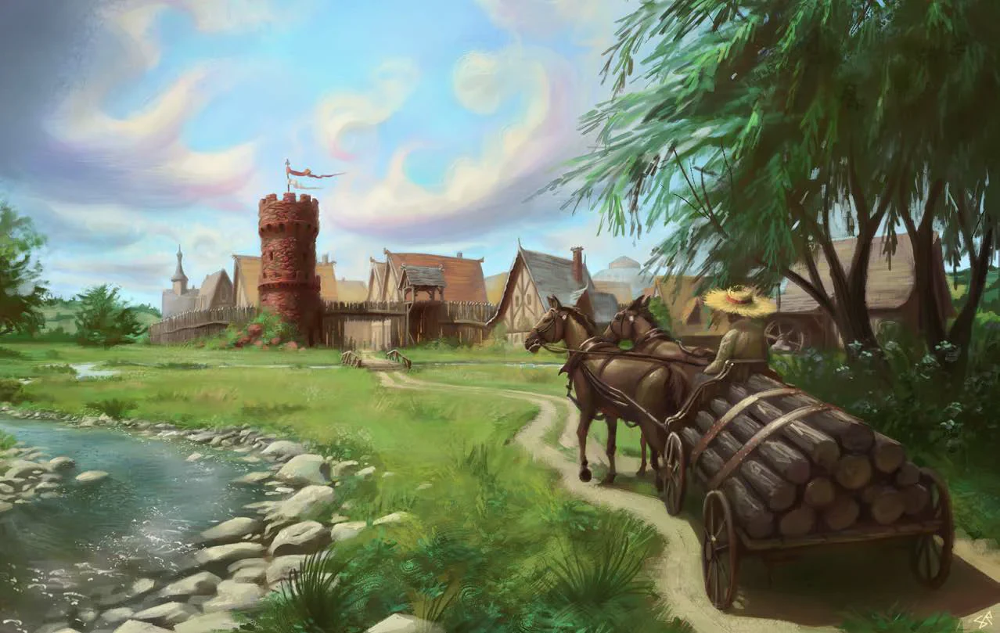
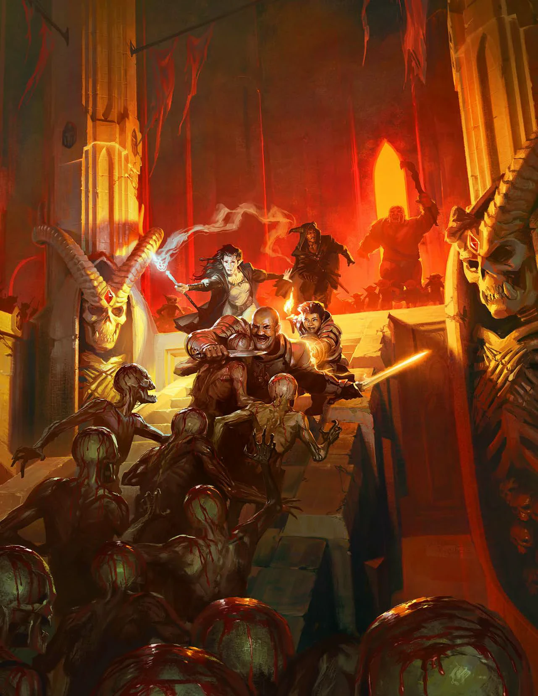

# A Cidadela Escarlate

{ .fj-arte .fj-arte-logo }

Guia dos jogadores. Sistema: Forja RPG.

## A Proposta

Torre Vermelha é uma vila de lenhadores na borda da Floresta Branca. Ela vive de quem chega querendo saquear a Cidadela Escarlate: um castelo de pedra vermelha em ruínas, no meio da mata, com túneis que descem mais fundo do que alguém já voltou para contar.

{ .fj-arte loading=lazy }

Vocês não são aventureiros. São gente comum da vila. Quem sair vivo da primeira descida vira aventureiro. Depois disso, a campanha é descer, recuar, voltar à vila e descer de novo, cada vez mais fundo.

## O Que Se Diz na Jaula

Boatos da taverna da vila. Alguns são verdade.

- O castelo era de uma família de feiticeiros. Cavaleiros o queimaram há mais de cem anos.
- O último dos feiticeiros ainda vive lá embaixo.
- Cada vez que alguém morre na Cidadela, uma pedra da torre da vila amanhece pintada de vermelho.
- Ursos-corujas e harpias guardam as ruínas.
- Lá embaixo há ouro antigo, livros proibidos e uma magia que corre pela terra.

{ .fj-arte .fj-arte-retrato loading=lazy }

## Quem É Você?

Cada jogador cria 4 personagens de nível 0 para [o Funil](../mestre/index.md#o-funil), sorteados (veja [Personagem Aleatório](../personagem/index.md#personagem-aleatorio)). Para cada um, responda duas perguntas em uma frase.

**Por que você vai entrar?** Escolha ou role 1d8.

| d8 | Motivo |
|---|---|
| 1 | Você deve dinheiro a alguém que não espera. |
| 2 | Alguém que você ama entrou na Cidadela e não voltou. |
| 3 | Você apostou na Jaula que traria uma prova lá de dentro. |
| 4 | A serraria te dispensou e há bocas para alimentar em casa. |
| 5 | Os mercadores da vila pagam por notícias de uma comerciante sumida na estrada. |
| 6 | Você sonha com o castelo toda noite. |
| 7 | Sua fé manda limpar aquele lugar. |
| 8 | O condestável Roch está atrás de você. |

**Quem na vila sente sua falta?** Escolha uma pessoa.

**Ariadna e Ambrozy.** Os irmãos donos da Jaula, a taverna construída dentro da costela de um gigante. Um hóspede deles sumiu há uma semana.

**Agniezka.** A ferreira, veterana de guerra, honesta e sempre resmungando.

**Cecylia.** A sacerdotisa de Rava, deusa das engrenagens. Compra qualquer sucata estranha.

**Eva.** Cuida do pomar e sabe da vida de todo mundo.

**Tobiasz.** O velho eremita do outro lado do rio. Xinga todo mundo que vai para a Cidadela.

### O SOBREVIVENTE

Ao chegar ao nível 1, responda: o que você viu lá embaixo e não consegue esquecer? Quem do grupo salvou sua vida? O que você quer encontrar lá agora? Os sobreviventes formam uma companhia. Ninguém fica para trás.

## Como Jogamos

**Recuar é esperado.** Há inimigos fortes demais para vocês, de propósito. Fujam e voltem com um plano.

**A masmorra reage.** O que vocês limparam pode estar ocupado de novo na volta.

**Luz e barulho denunciam.** Quase tudo lá embaixo enxerga no escuro e ouve de longe.

**Morte.** Personagem de nível 0 morre a 0 PV. Quem perder os quatro cria mais 1d4.

## Segurança

**Tom.** Fantasia sombria: mortos-vivos, cultos, demônios e loucura (veja [Sanidade](../mestre/encontros.md#sanidade)).

**Linhas.** Não aparecem: violência sexual; violência contra crianças.

**Véus.** Acontecem fora de cena: tortura; rituais de sangue; experimentos com prisioneiros.

**Pausa de um minuto.** Qualquer pessoa pode pedir uma pausa, sem explicar. Paramos, ajustamos e seguimos.

Tragam suas linhas e véus para a sessão zero.
