# A Cidadela Escarlate

{ .fj-arte .fj-arte-logo }

Um destino da campanha Aethelgard (veja Para Onde Agora? em [Aethelgard](aethelgard.md)).

## A Proposta

Torre Vermelha é uma vila de lenhadores na borda da Floresta Branca. Ela vive de quem chega querendo saquear a Cidadela Escarlate: um castelo de pedra vermelha em ruínas, no meio da mata, com túneis que descem mais fundo do que alguém já voltou para contar.

{ .fj-arte loading=lazy }

Depois da primeira descida, a campanha é descer, recuar, voltar à vila e descer de novo, cada vez mais fundo.

## Como Chegar

Torre Vermelha fica ao norte do lago, a 7 hexágonos a oeste de Java (veja Viagem). O castelo fica dentro da floresta, a noroeste da vila.

{ .fj-arte loading=lazy }

## O Que Se Diz na Jaula

Boatos da taverna da vila. Alguns são verdade.

- O castelo era de uma família de feiticeiros. Cavaleiros o queimaram há mais de cem anos.
- O último dos feiticeiros ainda vive lá embaixo.
- Cada vez que alguém morre na Cidadela, uma pedra da torre da vila amanhece pintada de vermelho.
- Ursos-corujas e harpias guardam as ruínas.
- Lá embaixo há ouro antigo, livros proibidos e uma magia que corre pela terra.

{ .fj-arte .fj-arte-retrato loading=lazy }

## Quem Mora na Vila

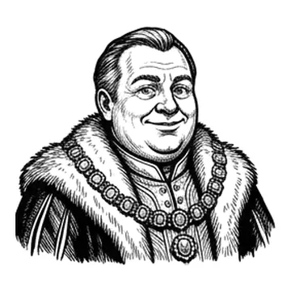{ loading=lazy }
**Wislaw Broz** *Prefeito, Prefeitura.* Bochechas rosadas, roupa fina de cidade grande. Recebe todo aventureiro com comida e bebida e oferece uma "autorização" para descontos nas lojas.

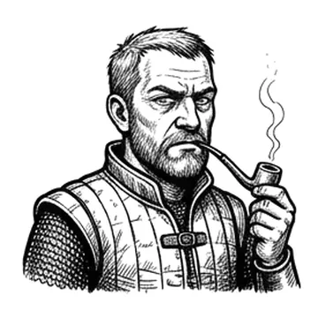{ loading=lazy }
**Roch** *Condestável, Prefeitura.* Calado, cheira a cachimbo. Chefia a milícia de 20 voluntários. Prende bêbados e briguentos: 25 po de multa ou uma noite na cela.

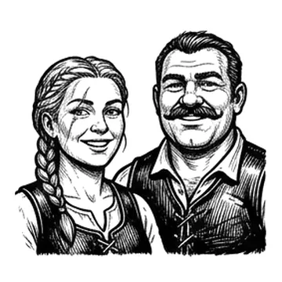{ loading=lazy }
**Ariadna e Ambrozy** *Donos da Jaula.* Irmãos Gjorski, batedores aposentados. A taverna fica na costela do gigante que a bisavó deles matou. O hóspede Ichbon, um halfling, sumiu há uma semana.

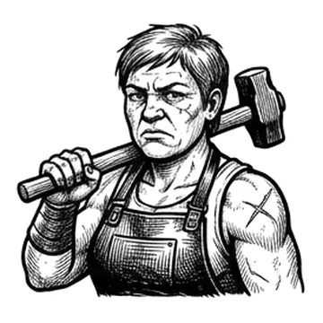{ loading=lazy }
**Agniezka** *Ferreira, Ferraria.* Uns 50 anos, cicatrizes de guerra. Preço justo e reclamação de graça. Compra metal estranho.

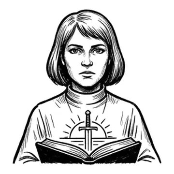{ loading=lazy }
**Cecylia** *Sacerdotisa de Woltander, Capela.* Séria e estudiosa. Cura por 10 po, vende pergaminhos e compra sucata trazida da Cidadela.

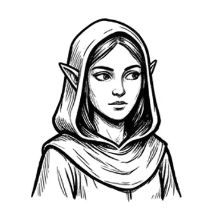{ loading=lazy }
**Norneth** *Acólita, Capela.* Meio-elfa, veio de longe. Quase não fala. Cuida da sucata que chega à capela.

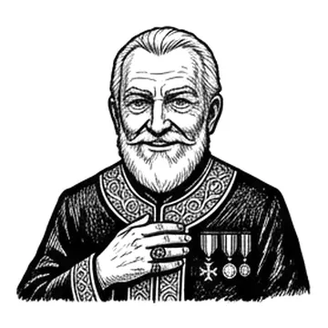{ loading=lazy }
**Konrad** *Mago de guerra aposentado, Casa.* Rico e falante. Voltou vivo da Cidadela. Convida aventureiros para jantar, conta histórias de guerra e vende itens mágicos.

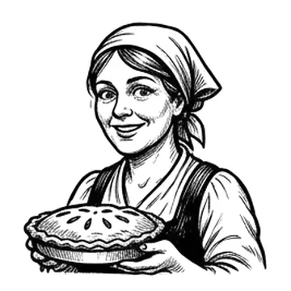{ loading=lazy }
**Eva** *Do pomar.* Sidra, torta e todas as fofocas da vila. O que alguém conta a ela, a vila inteira sabe no dia seguinte.

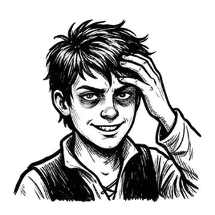{ loading=lazy }
**Gabe** *Filho de Eva, Pomar.* Adolescente, líder dos jovens da vila. Anda com olheiras fundas e finge que está tudo bem.

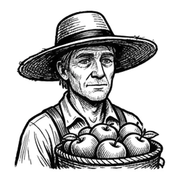{ loading=lazy }
**Cibor** *Marido de Eva, Pomar.* Quase não vem à vila. Troca frutas com as Corças do santuário da mata.

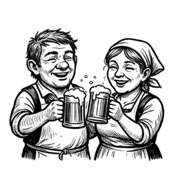{ loading=lazy }
**Remy e Mags** *Cervejaria Seiva Doce.* Casal halfling, sempre meio bêbado. Dão amostras da cerveja nova na porta. Quase todo halfling da vila é parente deles.

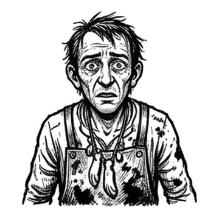{ loading=lazy }
**Witek** *Curtidor, Curtume.* Supersticioso, coberto de amuletos. Vende pés de coelho da sorte. O aprendiz dele, Hubert, derruba tudo.

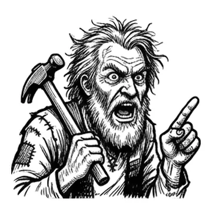{ loading=lazy }
**Tobiasz** *Eremita, do outro lado do rio.* Velho carpinteiro. Odeia quem vai à Cidadela e diz isso na cara. Um urso-coruja vive derrubando a cabana dele.

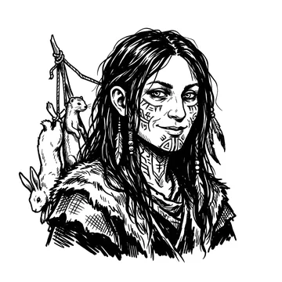{ loading=lazy }
**Zula** *Bruxa, no mato, perto da estrada de Java.* Vende poções mais baratas que a capela. Bichos mortos pendurados na varanda. Quase ninguém da vila vai lá.

## Como Jogamos

**Recuar é esperado.** Há inimigos fortes demais para vocês, de propósito. Fujam e voltem com um plano.

**A masmorra reage.** O que vocês limparam pode estar ocupado de novo na volta.

**Luz e barulho denunciam.** Quase tudo lá embaixo enxerga no escuro e ouve de longe.

## Segurança

**Tom.** Fantasia sombria: mortos-vivos, cultos, demônios e loucura (veja [Sanidade](../mestre/encontros.md#sanidade)).

**Linhas.** Não aparecem: violência sexual; violência contra crianças.

**Véus.** Acontecem fora de cena: tortura; rituais de sangue; experimentos com prisioneiros.

**Pausa de um minuto.** Qualquer pessoa pode pedir uma pausa, sem explicar. Paramos, ajustamos e seguimos.
