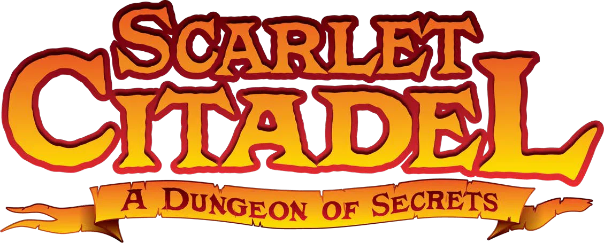
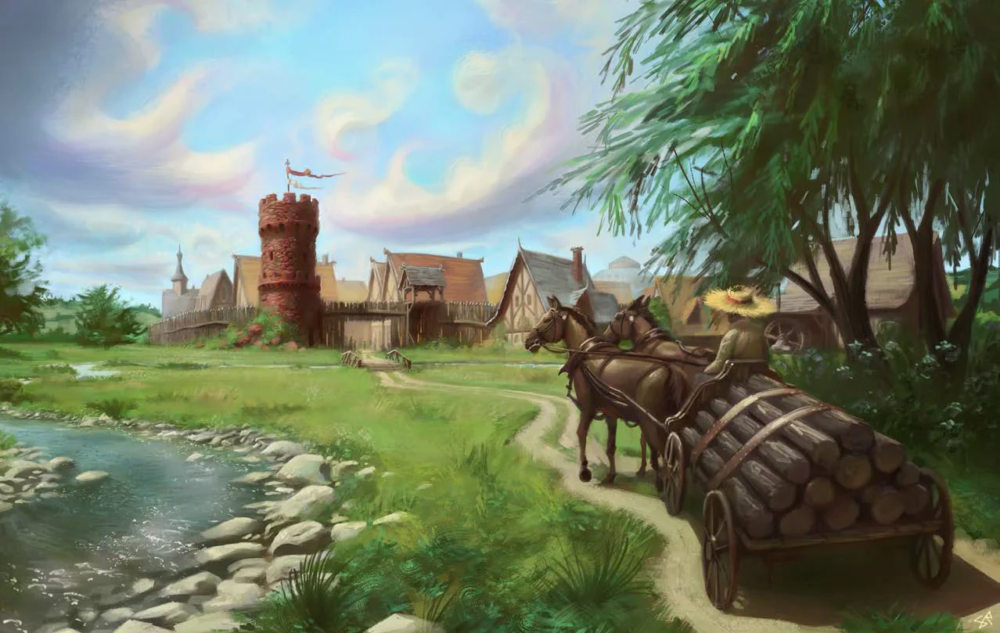
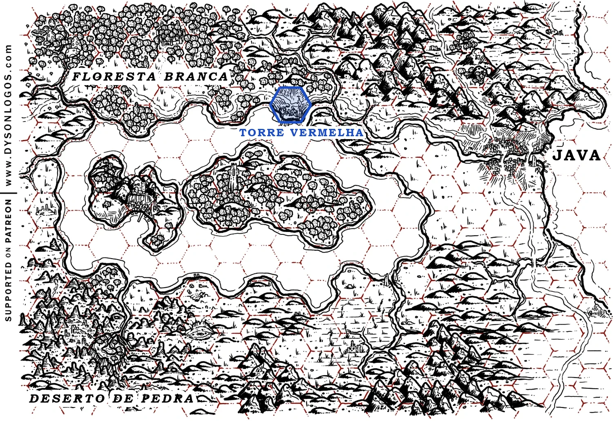
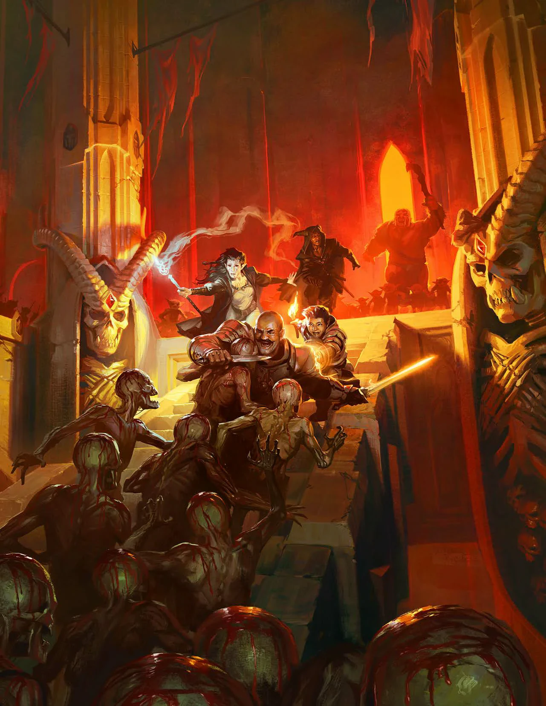

# A Cidadela Escarlate

{ .fj-arte .fj-arte-logo }

Um destino da campanha Aethelgard (veja Para Onde Agora? em [Aethelgard](aethelgard.md)).

## A Proposta

Torre Vermelha é uma vila de lenhadores na borda da Floresta Branca. Ela vive de quem chega querendo saquear a Cidadela Escarlate: um castelo de pedra vermelha em ruínas, no meio da mata, com túneis que descem mais fundo do que alguém já voltou para contar.

{ .fj-arte loading=lazy }

Depois da primeira descida, a campanha é descer, recuar, voltar à vila e descer de novo, cada vez mais fundo.

## Como Chegar

Torre Vermelha fica ao norte do lago, a 7 hexágonos a oeste de Java (veja Viagem). O castelo fica dentro da floresta, a noroeste da vila.

{ .fj-arte loading=lazy }

## O Que Se Diz na Jaula

Boatos da taverna da vila. Alguns são verdade.

- O castelo era de uma família de feiticeiros. Cavaleiros o queimaram há mais de cem anos.
- O último dos feiticeiros ainda vive lá embaixo.
- Cada vez que alguém morre na Cidadela, uma pedra da torre da vila amanhece pintada de vermelho.
- Ursos-corujas e harpias guardam as ruínas.
- Lá embaixo há ouro antigo, livros proibidos e uma magia que corre pela terra.

{ .fj-arte .fj-arte-retrato loading=lazy }

## Quem Mora na Vila

**Ariadna e Ambrozy.** Os irmãos donos da Jaula, a taverna construída dentro da costela de um gigante. Um hóspede deles sumiu há uma semana.

**Agniezka.** A ferreira, veterana de guerra, honesta e sempre resmungando.

**Cecylia.** Sacerdotisa de Woltander. Compra qualquer sucata estranha.

**Eva.** Cuida do pomar e sabe da vida de todo mundo.

**Tobiasz.** O velho eremita do outro lado do rio. Xinga todo mundo que vai para a Cidadela.

**Roch.** O condestável da vila.

## Como Jogamos

**Recuar é esperado.** Há inimigos fortes demais para vocês, de propósito. Fujam e voltem com um plano.

**A masmorra reage.** O que vocês limparam pode estar ocupado de novo na volta.

**Luz e barulho denunciam.** Quase tudo lá embaixo enxerga no escuro e ouve de longe.

## Segurança

**Tom.** Fantasia sombria: mortos-vivos, cultos, demônios e loucura (veja [Sanidade](../mestre/encontros.md#sanidade)).

**Linhas.** Não aparecem: violência sexual; violência contra crianças.

**Véus.** Acontecem fora de cena: tortura; rituais de sangue; experimentos com prisioneiros.

**Pausa de um minuto.** Qualquer pessoa pode pedir uma pausa, sem explicar. Paramos, ajustamos e seguimos.
