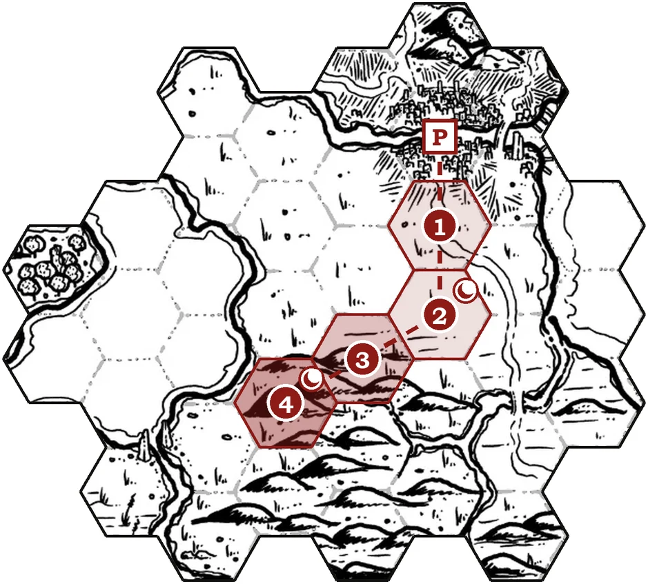

# Viagem

Viagens usam um mapa de hexágonos de 10 km.

**Ritmo.** O grupo viaja até 8 horas por dia, em dois trechos: manhã e tarde. À noite, acampa.

| Meio | Tempo por hexágono | Hexágonos por dia |
|---|---|---|
| A pé | 4 horas | 2 |
| Montado | 2 horas | 4 |
| Navegando | 1 hora | 8 |
| Terreno difícil | o dobro | metade |
| Terreno árduo | 8 horas | 1 |

**Marcha forçada.** Para cada hora além de 8, faça um teste de Constituição. A CD começa em 10 e aumenta 2 a cada hora extra. Se falhar, ganhe 1 ponto de exaustão.

**Navegação.** Em território desconhecido, o navegador do grupo faz um teste de Inteligência ao sair de cada hexágono. Se falhar, o grupo entra em um hexágono vizinho aleatório. Seguindo uma estrada, um rio ou uma costa, ninguém se perde.

**Comida e água.** Você aguenta 3 dias sem ração. A partir do quarto, ganhe 1 ponto de exaustão por dia. Você pode caçar e coletar 1 ração por dia com um teste de Inteligência.

## Encontros

O Mestre rola 1d6 ao entrar em cada hexágono e uma vez por noite de acampamento. O perigo da região diz o que o número significa.

| Perigo | Rolagens | Encontro ruim | Encontro bom |
|---|---|---|---|
| Seguro | 1 | nunca | 5–6 |
| Inseguro | 1 | 1 | 5–6 |
| Arriscado | 1 | 1–2 | 6 |
| Mortal | 2 | 1–3 | nunca |

**Encontro ruim.** Monstros, bandidos, uma emboscada, um perigo do caminho.

**Encontro bom.** Algo que ajuda: abrigo seguro, um mercador, notícias, um aliado, um atalho.

### Exemplo

{ .fj-arte-mapa loading=lazy }

O grupo sai a pé da cidade (P): dois hexágonos por dia. Quanto mais forte a cor, maior o perigo. A lua marca onde o grupo acampa.

| Quando | Hexágono | Terreno | Perigo | Rolagem |
|---|---|---|---|---|
| Dia 1, manhã | 1 | Planície | Seguro | ◯ |
| Dia 1, tarde | 2 | Planície | Seguro | ◯ |
| Noite | 2 | Planície | Seguro | ◯ |
| Dia 2, manhã | 3 | Morros | Inseguro | ◯ |
| Dia 2, tarde | 4 | Morros | Arriscado | ◯ |
| Noite | 4 | Morros | Arriscado | ◯ |

No hexágono 4, o Mestre tira 2: encontro ruim. Rola 1d6 na pilha de encontros ruins (veja Preparando Viagens) e sai uma matilha de lobos. À noite, tira 4: nada acontece.

Mapa de [Dyson Logos](https://dysonlogos.com).

## Tempo

Ao amanhecer, o Mestre rola 2d6. O tempo vale o dia e a noite.

| 2d6 | Tempo | Efeito |
|---|---|---|
| 2–3 | Estranho | Algo fora do comum: névoa que fala, sol vermelho. O Mestre decide. |
| 4 | Chuva forte | Terreno difícil. Fogueira só com abrigo. |
| 5 | Frio | Sem fogueira à noite, teste de Constituição CD 10 ou 1 ponto de exaustão. |
| 6 | Garoa | Vantagem para se esconder e para surpreender. |
| 7–8 | Bom | Nada muda. |
| 9 | Calor | Quem usa armadura média ou pesada faz Constituição CD 10 no fim do dia ou ganha 1 ponto de exaustão. |
| 10 | Ventania | Desvantagem em ataques com arco e besta. Tochas a céu aberto apagam. |
| 11–12 | Estranho | Algo fora do comum: chuva de estrelas, um sino debaixo da terra. O Mestre decide. |

**Por região.** Troque pelo que faz sentido: neve em vez de chuva na montanha, sol escaldante em vez de calor no deserto.
