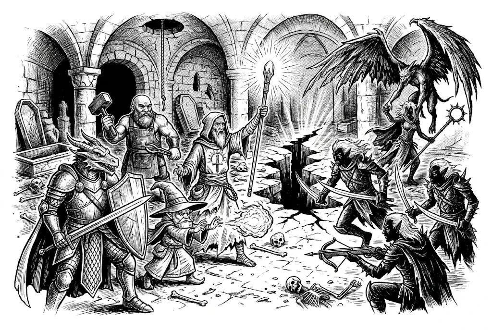

# Prompts de arte (Gemini / Nano Banana)

Gere todas as artes **na mesma conversa**, uma por mensagem, para o estilo ficar igual. Mande o prompt base uma vez com a primeira classe; depois, só "Same style, same rules. Next:" + a linha da classe.

Salve cada arte como `docs/assets/images/classes/<arquivo>.webp` (nome na tabela; converta para WebP com o fundo transparente: quase branco vira branco, e o alfa sai do escuro do traço, como em `guerreiro.webp`). Na página da classe, ponha a arte logo depois da epígrafe:

```markdown
{ .fj-arte .fj-arte-classe loading=lazy }
```

## Prompt base

```text
Black and white pen-and-ink illustration for an old-school fantasy RPG rulebook, in the gritty OSR style of books like Shadowdark: bold black ink lines, heavy solid blacks, crosshatching and stippling for shadows, rough hand-drawn texture, high contrast, no gray tones, no color.

Composition: one character, full body, dynamic pose, centered, vertical 3:4 format, with empty space around the figure. Loose ink splatter or a few smoke/debris strokes at the base are fine, but no scenery box.

Background: pure flat white (#FFFFFF) everywhere outside the drawing. No paper texture, no beige, no gradient, no vignette, no frame, no border.

No text, no letters, no logo, no signature, no watermark.

Character: [CLASSE]
```

**Como o autor preenche [CLASSE].** O nome da classe em inglês, e na linha de baixo a epígrafe da página da classe (a frase em itálico logo abaixo do título), traduzida para o inglês. Exemplo:

```text
Character: Arcane Legionary
Soldier-mages trained in war academies. On the front lines, magic courses through their blades; behind the ranks, it rains from the sky like artillery. A legionary knows when to advance and when to fall back, and never wastes a single spell.
```

A coluna da tabela abaixo é uma descrição visual opcional: dá para acrescentá-la depois da epígrafe quando a arte precisar de algum detalhe (uma arma, um animal, uma pose).

## Classes

| Classe | Arquivo | Linha para [CLASSE] |
|---|---|---|
| Guerreiro | guerreiro | A battle-scarred warrior in mismatched plate and chain armor, longsword in one hand and a dented shield in the other, standing firm, cape torn. |
| Sacerdote | sacerdote | A grim priest in chainmail and a hooded robe, raising a holy symbol that radiates light, a heavy mace in the other hand. |
| Ladino | ladino | A hooded thief crouching on a ledge, dagger drawn, a coin pouch and lockpicks on the belt, face half in shadow. |
| Mago | mago | A thin old wizard in a long robe with a staff, casting a crackling arcane spell from an open hand, books and scrolls hanging from the belt. |
| Bárbaro | barbaro | A huge barbarian in furs and leather, roaring mid-charge with a greataxe raised, scars and tribal paint on bare arms. |
| Patrulheiro | patrulheiro | A cloaked ranger drawing a longbow, a wolf companion at their side, leaves and branches at their feet. |
| Bardo | bardo | A charismatic bard in a feathered hat and travel clothes, playing a lute mid-song, a rapier at the hip. |
| Druida | druida | A druid in a cloak of leaves and bone ornaments, holding a gnarled staff, half of the body shifting into a bear, birds around. |
| Paladino | paladino | A holy knight in full plate with a tabard, holding a greatsword point-down in prayer, divine light behind the helmet. |
| Feiticeiro | feiticeiro | A young sorcerer with wild hair and glowing eyes, raw elemental fire and lightning bursting uncontrolled from both hands. |
| Monge | monge | A barefoot monk in simple wraps mid-kick, perfectly balanced on one foot, energy lines around the fists. |
| Alquimista | alquimista | A plague doctor with a beaked mask, wide-brimmed hat and long leather coat, holding up a smoking flask, vials and bombs on a bandolier. No magic. |
| Guerreiro Basilisco | guerreiro-basilisco | A tribal warrior covered in dried mud and stone flakes, glowing reptilian eyes, crouched to strike with a spear, a boomerang on the back. |
| Duelista | duelista | A swashbuckler musketeer in a plumed hat and cape, lunging with a rapier, smiling arrogantly, one hand behind the back. |
| Cavaleiro Verde | cavaleiro-verde | A towering knight in moss-covered armor with an antlered helm, holding a huge axe, vines and holly growing from the armor. |
| Cavaleiro Profano | cavaleiro-profano | A demonic death knight in spiked black plate armor, horned helm, burning eyes, a cursed sword in hand, skeletal hands rising from the ground around them. |
| Necromante | necromante | A gaunt necromancer in chainmail and a tattered cloak, longsword at the hip, raising a staff as skulls and skeletons rise in swirling smoke around them. |
| Lâmina Silenciosa | lamina-silenciosa | A masked samurai assassin in dark wraps, drawing a curved blade in a low stance, black lotus petals and smoke swirling around. |
| Lobo do Mar | lobo-do-mar | A raider in a winged helm with long braided hair, round shield and axe, one foot on the prow of a longboat, waves crashing below. |
| Ferreiro de Guerra | ferreiro-de-guerra | A burly blacksmith-artificer in a leather apron over patched armor, a heavy hammer in one hand and a smoking hand cannon in the other, a small brass spider-construct climbing on the shoulder, gears and tools hanging from the belt. |
| Sangue de Dragão | sangue-de-dragao | A warrior in fur and scale armor with a horned helm, shouting a blast of fire and wind from the mouth, a sword in hand, the faint shape of a dragon skull in the smoke behind them. |
| Caçador de Prata | cacador-de-prata | A grim monster hunter in a long coat and wide-brimmed hat, a silver longsword in one hand and a chain whip in the other, vials and stakes on a bandolier, a crossbow on the back, standing over a slain werewolf. |
| Dobrador Elemental | dobrador-elemental | A barefoot monk in simple wraps and a sash, in a dynamic martial arts stance, fire swirling around one fist, water whipping from the other hand, wind and small stones circling around the body. |
| Quebra-Feitiço | quebra-feitico | A muscular young warrior in torn simple clothes and light armor, gripping a huge rough sword wreathed in black, shredding anti-magic energy, cracked magic runes and broken spell circles shattering around him. |
| Carcereiro do Abismo | carcereiro-do-abismo | A sinister robed summoner with a hood and a chained grimoire, standing inside a burning ritual circle, holding a heavy chain that binds a snarling horned demon hound, small imps hiding in the smoke behind. |
| Legionário Arcano | legionario-arcano | A battle mage soldier in a steel breastplate and a military cloak, a longsword crackling with arcane lightning in one hand, the other hand raised casting a glowing rune, a small spellbook chained to the belt, ready to charge. |
| Sanguimante | sanguimante | A gaunt blood mage in a dark hooded robe with a bloody cut across the palm, ribbons of blood swirling out of the wound and forming a floating spear in the air, a ritual dagger in the other hand, faint veins glowing across the face. |
| Empíreo | empireo | A tall, unsettling figure in heavy plate armor and a torn tabard, a greatsword in one hand, the other hand raised with an extra eye open in the palm; a cracked halo of fire hovering crooked over the head, completely white eyes, cracks in the skin leaking light like broken porcelain, six half-formed wings bursting from the back, some feathered, some bare bone and torn skin. Strange and grotesque, not beautiful or cute. |
| Retornado | retornado | The same undead warrior shown four times side by side, left to right, as the body rots: a fresh corpse with grey skin and dead eyes; a rotting ghoul with long claws and torn flesh; a bare skeleton in the same rusted armor; a pale floating ghost, faded at the edges. Same armor scraps, same weapon, same pose in all four. |
| Mente Mestra | mente-mestra | A gaunt, sharp-featured schemer in a long worn coat, hollow cheeks and cold narrow eyes, one hand resting on a cane, the other holding up a single chess piece between two fingers. Thin threads run from their fingertips down to small scattered chess pieces and pinned notes at their feet, like puppet strings. A magnifying lens and a ring of keys hang from the belt. Unsettling, not handsome. |
| Bastião | bastiao | A huge, stocky dwarf knight in full heavy plate armor, dented and scarred by countless blows, behind an enormous tower shield as tall as he is, covered in dents, scratches and broken arrow shafts stuck in it. Closed helmet with a narrow visor slit, thick braided beard spilling out under it. He braces the shield against the ground, planted like a wall, a short heavy warhammer in the other hand, held low. Brutish and immovable, not heroic or pretty. |
| Ilusionista | ilusionista | A scrawny, hunched goblin illusionist with huge ears, a crooked grin full of sharp little teeth and wide, gleeful eyes, wearing an oversized patched robe and a floppy hood. With long bony fingers it weaves the air like a puppeteer: around it float several distorted copies of itself, half-formed and fading at the edges, each with a slightly different grin, and a ghostly wolf made of smoke lunges out from behind it. One copy is cracking apart like broken glass. Sly and unsettling, not cute. |
| Xamã | xama | A towering, scarred half-orc shaman with tusks, a shaved head painted with white ash handprints and a necklace of bones, teeth and small carved idols, wearing ragged furs. Mid-chant, eyes rolled back, beating a war drum strapped to the hip. Around and behind him rise his spirits, pale and translucent, faded at the edges: a huge ghostly wolf, the armored ghost of an old warrior ancestor with an axe, and a crow made of smoke. Wild and primal, not noble or pretty. |
| Arcanista Selvagem | arcanista-selvagem | The same tiefling woman shown three times, side by side from left to right like a corruption chart, each figure overlapping the next a little, the last one slightly in front. LEFT: young and whole, intact curled horns, clean skin, long hair, a neat robe, a small spark of magic in one hand, a curious smile. MIDDLE: one horn cracked, strange sigils and scale-like marks spreading over her face and arms, eyes turned white, hair thinning on one side, robe frayed, an unstable fire crackling in her hand. RIGHT: barely recognizable, one horn broken off, skin mostly scales and glowing sigils, bald patches, a third eye opening on the forehead, one arm become a mass of thin tentacles, robe in rags hung with charms and burnt scrolls, hurling a ball of fire that splits apart into sparks, small frogs and burning symbols, a manic, ecstatic grin. Unsettling, not glamorous or pretty. Vertical 3:4 format, not a wide lineup. |
| Metamorfo | metamorfo | Movie-poster composition. In front, a gaunt, haunted human man, shaved head carved with old scars and crude symbols, bare scarred torso, heavy iron chains wrapped tightly around his body and arms, a big padlock hanging on his chest, iron manacles on his wrists, a ragged cloak, head bowed, eyes full of dread, holding the chains like he is holding something in. Behind him, rising out of his own shadow and much larger than him, his other forms loom like ghosts: a snarling werewolf, a hulking brute with huge fists, a tentacled horror full of eyes and mouths, a swarm of crows and rats, a great serpent and a stone gargoyle with spread wings, all half-merged into one monstrous shape. |
| Malvidente | malvidente | A hunched seer-witch with milky white eyes, casting bones from one hand, a raven on the shoulder and a bubbling cauldron behind. |

## Dicas

- **Fundo.** Se vier com fundo bege ou cinza, peça: "Make the background pure flat white #FFFFFF." O site cuida do resto: no tema claro o branco vira pergaminho; no escuro a arte inverte e vira traço claro.
- **Rosto e corpo.** Para variar ancestralidade e gênero, acrescente na linha, por exemplo, "a dwarf woman" ou "an orc man".
- **Formato.** Mantenha sempre 3:4 vertical, para todas as páginas terem o mesmo tamanho de arte.

## Ancestralidades

Retratos pequenos para os cartões de Ancestralidades: **dois rostos da mesma ancestralidade, um masculino e um feminino, lado a lado**. Escolha a proporção **4:3** no Gemini. Use uma conversa nova só para eles, com o prompt abaixo na primeira e depois "Same style, same rules. Next:" + a linha.

Salve como `docs/assets/images/ancestralidades/<arquivo>.webp` (mesmo tratamento das classes). No cartão, ponha a arte logo depois da epígrafe; ela vai para o canto direito, ao lado do título:

```markdown
{ .fj-arte-ancestral loading=lazy }
```

```text
Black and white pen-and-ink portraits for an old-school fantasy RPG rulebook, in the gritty OSR style of books like Shadowdark: bold black ink lines, solid blacks, crosshatching for shadows, rough hand-drawn texture, high contrast, no gray tones, no color.

Composition: two head-and-shoulders portraits of the same fantasy people side by side, a man on the left and a woman on the right, both in three-quarter view turned slightly toward each other. Same scale, same style, same eye level, a little empty space between and around them. Horizontal 4:3 format. Simple, strong shapes that still read clearly when printed small (about 5 cm wide): big shadows, few fine details.

Background: pure flat white (#FFFFFF) everywhere outside the drawing. No paper texture, no beige, no gradient, no vignette, no frame, no border, no circles or panels behind the heads.

No text, no letters, no logo, no signature, no watermark.

People: [ANCESTRALIDADE]
```

| Ancestralidade | Arquivo | Linha para [ANCESTRALIDADE] |
|---|---|---|
| Humano | humano | Humans: weathered adventurers with determined, ambitious stares; one has a scar on the cheek, the other a traveler's hood. |
| Anão | anao | Dwarves: stern and stocky; he has a long beard braided with metal rings, she has thick braided hair with metal rings; heavy iron helm or fur collar. |
| Elfo | elfo | Elves: elegant, with long pointed ears, long straight hair and calm, ageless faces; thin circlets on the brow. |
| Drow | drow | Drow: skin rendered in solid black ink and hatching, long white hair, long pointed ears, cruel and elegant expressions, spider-shaped jewelry. |
| Meio-elfo | meio-elfo | Half-elves: slightly pointed ears, a mix of human and elven features, friendly half-smiles, traveling cloaks. |
| Halfling | halfling | Halflings: small folk with curly hair, round cheeks and cheerful, confident faces; one holds a long pipe. |
| Draconato | draconato | Dragonborn: reptilian heads with swept-back horns and scaled skin, smoke curling from the nostrils; she has a slightly slimmer snout and a frill. |
| Gnomo | gnomo | Gnomes: big noses, wild hair, mischievous grins, brass goggles pushed up on the forehead. |
| Orc | orc | Orcs: fierce faces with big tusks, heavy brows, war paint and fur collars. |
| Meio-orc | meio-orc | Half-orcs: small tusks, strong jaws and stoic expressions; one has a broken nose, the other a worn hood. |
| Tiefling | tiefling | Tieflings: large curved horns, blank pupil-less eyes and sly smiles, tail tips curling over the shoulders. |
| Goblin | goblin | Goblins: huge ears, sharp crooked teeth, wide nervous eyes; one holds a dagger close to the face. |
| Autômato | automato | Automatons: faces of riveted metal plates, glowing eye slits, visible gears and cables at the neck; one with a broad, heavy build, the other with a slender, graceful build. |

## Símbolos de Divindades

Símbolos sagrados para os cartões de divindade das campanhas. Escolha a proporção **1:1** no Gemini. Salve como `docs/assets/images/<campanha>/<arquivo>.webp` (mesmo tratamento das classes). No cartão, ponha a arte logo depois da epígrafe; ela vai para o canto direito, ao lado do título:

```markdown
{ .fj-arte-ancestral loading=lazy }
```

```text
Black and white pen-and-ink holy symbol for an old-school fantasy RPG rulebook, in the gritty OSR style of books like Shadowdark: bold black ink lines, solid blacks, rough hand-drawn texture, high contrast, no gray tones, no color.

Composition: a single emblem, centered, square 1:1 format, with empty space around it. Simple, strong, symmetrical shapes that still read clearly when printed small (about 4 cm wide), like a symbol carved on a shield or stamped on a medallion.

Background: pure flat white (#FFFFFF) everywhere outside the drawing. No paper texture, no beige, no gradient, no vignette, no frame, no border, no circle behind the emblem.

No text, no letters, no logo, no signature, no watermark.

Symbol: [SÍMBOLO]
```

| Divindade | Arquivo | Linha para [SÍMBOLO] |
|---|---|---|
| Woltander (Aethelgard) | aethelgard/woltander | A straight longsword pointing down, its blade driven into a flat horizon line; a half sun rises from the horizon behind the crossguard, with straight rays fanning out. The crossguard and the horizon together suggest a cross, but it must not look like a Christian cross. |

## Página Inicial

Duas artes no estilo charge das de Equipamento: uma cena grande na abertura e uma vinheta fechando os três pilares. O que dá o ar de quadrinho: a linha "A touch of dark humor is welcome", **uma piada visual** (alguém se dando mal ao lado de alguém tranquilo), poucos elementos, formas grandes e **personagens estranhos** (feios, tortos, nada fofos; sem isso o Gemini tende ao desenho infantil). Cada prompt está completo; dá para colar numa conversa nova.

Salve como `docs/assets/images/inicio/<arquivo>.webp` (mesmo tratamento das classes).

| Arquivo | Formato | Lugar em `docs/index.md` | Markdown |
|---|---|---|---|
| abertura | 3:2 | entre `# Forja RPG` e o primeiro parágrafo | `{ .fj-arte .fj-arte-cena loading=lazy }` |
| forja | 1:1 | depois de **Criatividade acima das regras**, antes de `## POR ONDE COMEÇAR` | `{ .fj-arte-vinheta .fj-arte-fim loading=lazy }` |

**abertura** (3:2)

A primeira versão saiu infantil: halfling com cara de criança, olhos grandes, gotas de suor de mangá, dragão bonitinho. O autor gosta de **personagens estranhos**: feios, tortos, maltratados. Esta versão pede isso.

```text
Black and white pen-and-ink illustration for an old-school fantasy RPG rulebook, in the gritty OSR style of books like Shadowdark and of 1980s underground comix and dungeon zines: bold black ink lines, heavy solid blacks, crosshatching and stippling for shadows, rough hand-drawn texture, high contrast, no gray tones, no color. A touch of dark humor is welcome.

The characters are strange, ugly and grotesque, not cute: odd proportions, crooked noses, bad teeth, warts, scars, bags under the eyes, gaunt or lumpy faces, dirty and worn-out gear. Not cartoonish, not manga, not for children: no big round eyes, no sweat drops, no emotion marks, no chibi proportions.

Composition: one wide scene, horizontal 3:2 format. The edges of the scene fade into pure flat white (#FFFFFF): no paper texture, no beige, no gradient, no vignette, no frame, no border.

No text, no letters, no numbers, no labels, no signature, no watermark.

Scene: a dragon's lair in a deep cave, bones scattered among the treasure. An ancient, scarred dragon with warty hide, a torn wing and broken teeth sleeps curled on a mountain of gold coins, cups and crowns, smoke curling from its nostrils. Four adventurers sneak in on tiptoe: a squat, one-eyed dwarf in dented armor freezes mid-step, grimacing, as a coin rolls away from his boot; a middle-aged halfling thief with a stubbly face, a crooked nose and rotten teeth is already on the pile, stuffing coins into his shirt with a greedy leer; a gaunt, wild-eyed old wizard with long dirty fingernails holds up a guttering candle and presses a finger to his lips; a pale, hollow-cheeked knight in an ill-fitting helm slowly draws his sword at the back. One of the dragon's eyes is half open, watching them.
```

Na mesma conversa do Gemini, dá para pedir só o ajuste: "Same scene and composition, but make every character strange, ugly and grotesque, like 1980s underground comix: odd proportions, crooked noses, bad teeth, warts, scars, gaunt faces. Not cute or cartoonish: no big eyes, no sweat drops. The halfling is a middle-aged man with stubble, not a child."

Feito com o prompt novo: está em `docs/assets/images/inicio/abertura.webp` (995 × 659) e na página inicial.

**forja** (1:1)

```text
Black and white pen-and-ink illustration for an old-school fantasy RPG rulebook, in the gritty OSR style of books like Shadowdark: bold black ink lines, heavy solid blacks, crosshatching and stippling for shadows, rough hand-drawn texture, high contrast, no gray tones, no color. A touch of dark humor is welcome.

Composition: a small vignette, square 1:1 format, centered, with lots of empty space around it. Few elements, big clear shapes that still read clearly when printed small. Background: pure flat white (#FFFFFF) everywhere outside the drawing: no paper texture, no beige, no gradient, no vignette, no frame, no border.

No text, no letters, no numbers, no labels, no signature, no watermark.

Scene: a stocky dwarf blacksmith with a big beard and a leather apron raises his hammer over an anvil, sparks flying, proudly forging a brand new adventurer: a small, dazed human warrior sitting on the anvil in fresh armor, steaming hot, with a sword already in hand. Beside the anvil, the legs of another freshly forged adventurer stick out of a quenching barrel, steam rising.
```

Feito: está em `docs/assets/images/inicio/forja.webp` (669 × 682) e na página inicial.

## Equipamento

Artes da página Equipamento: **pranchas** (o equipamento exposto, como num catálogo antigo) e **vinhetas** (uma regra acontecendo, com um pouco de humor). Use uma conversa nova só para elas: mande o prompt abaixo com a primeira linha e depois "Same style, same rules. Next:" + a linha. **Troque a proporção no Gemini a cada arte**, conforme a coluna Formato.

Salve como `docs/assets/images/equipamento/<arquivo>.webp` (mesmo tratamento das classes: fundo transparente, alfa saindo do traço). As artes não têm texto; quando for preciso dizer o que é cada peça, a legenda vai em itálico logo abaixo da arte.

```text
Black and white pen-and-ink illustration for an old-school fantasy RPG rulebook, in the gritty OSR style of books like Shadowdark: bold black ink lines, heavy solid blacks, crosshatching and stippling for shadows, rough hand-drawn texture, high contrast, no gray tones, no color. A touch of dark humor is welcome.

Background: pure flat white (#FFFFFF) everywhere outside the drawing; the edges of the scene fade into white. No paper texture, no beige, no gradient, no vignette, no frame, no border.

No text, no letters, no numbers, no labels, no signature, no watermark.

Format: [FORMATO]
Scene: [CENA]
```

| Arte | Arquivo | Formato | Linha para [CENA] |
|---|---|---|---|
| Abertura | loja | horizontal 3:2 | A cramped, cluttered blacksmith and outfitter shop. Behind the counter, a stocky dwarf smith proudly shows a longsword. In front, three adventurers shop: one tries on a helmet far too big that falls over his eyes, one counts a small pile of gold coins on the counter with a suspicious frown, one inspects a crossbow. Weapons and armor hang on every wall, a forge glows in the back. |
| Funil | funil | horizontal 3:2 | Four frightened peasants at the entrance of a dark dungeon, armed with whatever they found: a farmer gripping a crowbar, a woman holding a long wooden pole, a boy wearing a frying pan as a helmet and clutching a sack of caltrops, an old man holding a torch as far from his body as he can. Muddy clothes, no armor, nervous faces. |
| Carga | carga | quadrado 1:1 | An adventurer bent almost double under an absurdly tall backpack: rope, pots, a ladder, a chest, a shovel, torches and a stuffed deer head tied on top, sweat running down the face. Beside him, a mule carrying nothing looks at him with contempt. |
| Armaduras | armaduras | horizontal 16:9 | An armor catalog plate: eight suits of armor on wooden armor stands, in one straight row, all at the same scale and facing the viewer, from lightest on the left to heaviest on the right: 1. plain leather armor; 2. studded leather armor with metal rivets; 3. hide armor of thick furs and pelts; 4. a chain mail shirt; 5. a polished steel breastplate over a padded coat; 6. a heavy coat of large iron rings sewn on leather; 7. splint armor of vertical metal strips; 8. full plate armor with a closed helm. On the wall above them hang three shields, left to right: a small round buckler, a round wooden shield, a tall tower shield. |
| Não pode nadar | nadar | quadrado 1:1 | Seen from the side, at water level, with nothing drawn underwater: a calm river surface drawn as a few simple horizontal ink lines. On the left, only the closed helm of a knight in full plate sticks out of the water, sinking, with a few bubbles and one gauntlet raised above it. On the right, a grinning rogue in light leather armor swims on the surface with easy strokes, head and shoulders above the water, a dagger held in the teeth, looking back at the knight. Few elements, big clear shapes, lots of white around them. (A primeira versão, com o corte embaixo d'água, ficou confusa.) |
| Kit de exploração | kit | horizontal 3:2 | Flat lay seen from directly above, like a plate in an old equipment catalog: an open leather backpack in the center, and its contents laid out neatly around it, every object separate and easy to read: a flint and steel, five torches, three rations wrapped in cloth, a coiled rope, a grappling hook, ten iron spikes. |

**Onde entra cada uma** (em `docs/equipamento.md`):

| Arquivo | Lugar | Markdown |
|---|---|---|
| loja | entre `# Equipamento` e `## Moeda` | `{ .fj-arte .fj-arte-cena loading=lazy }` |
| funil | depois da tabela d12 do Nível 0 | `{ .fj-arte .fj-arte-cena loading=lazy }` |
| carga | logo depois de `## Carga` | `{ .fj-arte-vinheta loading=lazy }` |
| armaduras | logo depois de `## Armaduras`, com a legenda na linha de baixo: `*Da esquerda para a direita: Couro, Couro batido, Gibão de peles, Cota de malha, Peitoral, Cota de anéis, Cota de talas e Placas. Na parede: Broquel, Escudo e Escudo de torre.*` | `{ .fj-arte .fj-arte-cena loading=lazy }` |
| nadar | no fim de Armaduras, logo antes de `## Equipamento Básico` | `{ .fj-arte-vinheta .fj-arte-fim loading=lazy }` |
| kit | depois do parágrafo do Kit de Exploração | `{ .fj-arte .fj-arte-cena loading=lazy }` |

### Armas

Quatro artes para a seção Armas, cada prompt completo. Mesmo tratamento e mesma pasta das outras de Equipamento.

| Arquivo | Formato | Lugar | Classes |
|---|---|---|---|
| armas-simples | 16:9 | logo depois de `## Armas`, antes da tabela, com legenda | `.fj-arte .fj-arte-cena` |
| armas-marciais | 16:9 | logo depois da tabela, antes de `**Desarmado.**`, com legenda | `.fj-arte .fj-arte-cena` |
| propriedades | 3:2 | logo depois de `### PROPRIEDADES` | `.fj-arte .fj-arte-cena` |
| pesada | 1:1 | no fim de Propriedades, antes de `## Armaduras` | `.fj-arte-vinheta .fj-arte-fim` |

Legendas: *Da esquerda para a direita: Adaga, Azagaia, Bumerangue, Bordão, Clava, Lança, Boleadeira, Shuriken, Zarabatana, Arco curto e Besta leve.* e *Em cima: Chicote, Cimitarra, Corrente de lâminas, Espada curta, Florete, Machadinha, Maça, Mangual e Espada longa. Embaixo: Machado de batalha, Martelo de guerra, Alabarda, Pique, Espadão, Machado grande, Arco longo e Besta pesada.*

**armas-simples** (16:9)

```text
Black and white pen-and-ink illustration for an old-school fantasy RPG rulebook, in the gritty OSR style of books like Shadowdark: bold black ink lines, heavy solid blacks, crosshatching and stippling for shadows, rough hand-drawn texture, high contrast, no gray tones, no color.

Composition: an equipment catalog plate, wide horizontal 16:9 format. Background: pure flat white (#FFFFFF) everywhere outside the drawing: no wall, no paper texture, no beige, no gradient, no vignette, no frame, no border.

No text, no letters, no numbers, no labels, no signature, no watermark.

Scene: eleven simple weapons standing upright side by side in one straight row on a plain wooden weapon rack, at realistic relative sizes, each one separate and easy to read, from left to right:
1. a dagger;
2. a javelin;
3. a wooden boomerang;
4. a quarterstaff;
5. a rough wooden club;
6. a spear;
7. a bola: three weights tied together by cords, hanging from a peg;
8. three shuriken throwing stars hanging from a peg;
9. a blowgun with a few darts;
10. a short bow with a quiver of arrows;
11. a light crossbow.
```

**armas-marciais** (16:9)

```text
Black and white pen-and-ink illustration for an old-school fantasy RPG rulebook, in the gritty OSR style of books like Shadowdark: bold black ink lines, heavy solid blacks, crosshatching and stippling for shadows, rough hand-drawn texture, high contrast, no gray tones, no color.

Composition: an equipment catalog plate, wide horizontal 16:9 format. Background: pure flat white (#FFFFFF) everywhere outside the drawing: no wall, no paper texture, no beige, no gradient, no vignette, no frame, no border.

No text, no letters, no numbers, no labels, no signature, no watermark.

Scene: a plain wooden weapon rack with two tiers, the weapons standing upright side by side, at realistic relative sizes, each one separate and easy to read.
Top tier, nine one-handed weapons, left to right: 1. a coiled leather whip hanging from a peg; 2. a curved scimitar; 3. a coiled chain with small blades along its links, hanging from a peg; 4. a short sword; 5. a slender rapier with a swept hilt; 6. a hand axe; 7. a flanged mace; 8. a flail with a spiked ball on a chain; 9. a longsword.
Bottom tier, eight big weapons, left to right: 1. a battleaxe; 2. a warhammer; 3. a halberd; 4. a very long pike; 5. a greatsword; 6. a huge two-handed greataxe; 7. a longbow; 8. a heavy crossbow with a crank.
```

**propriedades** (3:2)

```text
Black and white pen-and-ink illustration for an old-school fantasy RPG rulebook, in the gritty OSR style of books like Shadowdark: bold black ink lines, heavy solid blacks, crosshatching and stippling for shadows, rough hand-drawn texture, high contrast, no gray tones, no color. A touch of dark humor is welcome.

Composition: one wide action scene, horizontal 3:2 format, with only four fighters so it reads clearly. The edges of the scene fade into pure flat white (#FFFFFF): no paper texture, no beige, no gradient, no vignette, no frame, no border.

No text, no letters, no numbers, no labels, no signature, no watermark.

Scene: four adventurers fight a charging band of orcs in a ruined courtyard:
1. two separate soldiers, each with his own weapon: in front, a shield-bearer crouches behind a big round shield, holding only the shield and a short sword; behind him, a pikeman ALONE grips a very long pike with both of his own hands and thrusts it over the shield-bearer's head at an orc two steps away. The shield-bearer does not touch the pike;
2. a dwarf throws a hand axe that spins through the air toward an orc;
3. a sweating crossbowman frantically cranks his heavy crossbow while an orc runs straight at him;
4. a warrior swings a longsword with both hands in a wide arc.
```

Se só a dupla do pique sair errada, peça a correção na mesma conversa, em vez de gerar tudo de novo: "Keep everything else exactly the same. Fix the two soldiers on the left: the man in front holds only a round shield and a short sword and does not touch the pike; the man behind holds the pike alone, with both of his hands."

**pesada** (1:1)

```text
Black and white pen-and-ink illustration for an old-school fantasy RPG rulebook, in the gritty OSR style of books like Shadowdark: bold black ink lines, heavy solid blacks, crosshatching and stippling for shadows, rough hand-drawn texture, high contrast, no gray tones, no color. A touch of dark humor is welcome.

Composition: a small vignette, square 1:1 format, centered, with lots of empty space around it. Few elements, big clear shapes that still read clearly when printed small. Background: pure flat white (#FFFFFF) everywhere outside the drawing: no paper texture, no beige, no gradient, no vignette, no frame, no border.

No text, no letters, no numbers, no labels, no signature, no watermark.

Scene: a small, skinny halfling tries to swing a huge greatsword much taller than himself; the weight of the blade pulls him off balance and he topples backward, feet in the air. Beside him, a big bored orc with arms crossed watches, unimpressed.
```

**Vinheta.** A classe `fj-arte-vinheta` deixa a arte pequena, à direita do texto corrido, que passa ao lado dela (como num livro de RPG). Títulos, tabelas e listas de regras começam sempre abaixo dela, então ponha a vinheta antes de um trecho de texto comum. Onde não há texto comum (como em Armaduras), some `.fj-arte-fim`: ela fica pequena e centralizada, fechando a seção. No celular a vinheta vai para o centro.

## NPCs de Campanha

Retratos para as folhas de "Quem É Quem" que o Mestre mostra aos jogadores. Escolha a proporção **1:1** no Gemini. Use uma conversa nova para cada vila, com o prompt abaixo na primeira e depois "Same style, same rules. Next:" + a linha.

Salve do jeito que vier (png ou jpg) em `campanhas/<campanha>/retratos/<arquivo>.png`, com o nome da tabela. Rode `python campanhas/aethelgard/gerar.py`: o retrato entra no cartão sozinho. Quem ainda não tem arte sai com um quadro vazio.

**Vários numa imagem só.** Dá para pedir todos numa grade (14 em 4 × 4 deu certo para Torre Vermelha, mas cada retrato sai com uns 250 pixels). Para cortar a grade em um arquivo por NPC, na ordem de leitura:

```bash
python campanhas/aethelgard/recortar_retratos.py grade.png broz roch ariadna-ambrozy agniezka cecylia norneth konrad eva gabe cibor remy-mags witek tobiasz zula
```

```text
Black and white pen-and-ink portrait for an old-school fantasy RPG rulebook, in the gritty OSR style of books like Shadowdark: bold black ink lines, solid blacks, crosshatching for shadows, rough hand-drawn texture, high contrast, no gray tones, no color.

Composition: one head-and-shoulders portrait in three-quarter view, centered, square 1:1 format, with a little empty space around it. If the line describes two people, draw them side by side at the same scale and eye level, turned slightly toward each other. Simple, strong shapes and a clear, memorable face that still read clearly when printed small (about 4 cm wide): big shadows, few fine details.

Background: pure flat white (#FFFFFF) everywhere outside the drawing. No paper texture, no beige, no gradient, no vignette, no frame, no border, no circle or panel behind the head.

No text, no letters, no logo, no signature, no watermark.

Person: [NPC]
```

### Torre Vermelha (Aethelgard)

Pasta: `campanhas/aethelgard/retratos/`.

| NPC | Arquivo | Linha para [NPC] |
|---|---|---|
| Wislaw Broz | broz | A plump, rosy-cheeked human mayor in his fifties, in fine city clothes with a fur collar and a heavy chain of office, smiling a too-friendly salesman's smile. |
| Roch | roch | A stern middle-aged human constable with a short beard and narrowed, suspicious eyes, a long pipe in his mouth, a padded jerkin over a chain shirt. |
| Ariadna e Ambrozy | ariadna-ambrozy | A human sister and brother in their forties, innkeepers and retired scouts, in leather vests: she has braided hair and a scar on her cheek; he is broad with a thick mustache. Both cheerful, ready to tell a story. |
| Agniezka | agniezka | A stocky human woman blacksmith in her fifties, short gray hair, muscular scarred arms, leather apron, a hammer on her shoulder and a grumpy frown. |
| Cecylia | cecylia | A serious, studious human priestess with short hair and a plain robe, holding an open book; on her chest, a holy symbol of a sword driven point-down into the horizon with a half sun rising behind the crossguard. |
| Norneth | norneth | A young half-elf acolyte woman with slightly pointed ears, in a plain hooded robe, quiet and watchful, her sharp eyes glancing sideways at the viewer's belongings. |
| Konrad | konrad | An old, wealthy human battlemage with a neat white beard, an embroidered robe with military medals and a jeweled ring, smiling warmly but with calculating eyes. |
| Eva | eva | A cheerful human woman in her forties with a headscarf, holding an apple pie, leaning in with a curious, gossiping smile. |
| Gabe | gabe | A human teenage boy with messy hair and a cocky grin, but deep dark circles under his eyes, rubbing his temple. |
| Cibor | cibor | A quiet, weathered human farmer in a wide straw hat, holding a basket of enormous apples, with a calm, distant gaze. |
| Remy e Mags | remy-mags | A halfling husband and wife, merry brewers in aprons, both a little tipsy, with rosy noses and foaming mugs raised in a toast. |
| Witek | witek | A wiry, nervous human tanner with many charms, amulets and rabbit's feet hanging from his neck, a stained leather apron and darting eyes. |
| Tobiasz | tobiasz | An old human hermit carpenter with wild white hair and beard, patched clothes and a carpenter's hammer, shouting angrily with a pointing finger. |
| Zula | zula | A pale human witch with long dark hair and tattoos on her face, small dead animals hanging behind her shoulder, smiling as if she knows a secret. |

### Aethelgard: grades prontas

Duas grades para colar inteiras no Gemini (1:1). Salve cada uma em `campanhas/aethelgard/retratos/` e corte com o comando embaixo dela. Se algum sair errado, refaça só ele com o prompt de retrato único acima.

**Grade 1: Java e a estrada** (16 retratos, 4 × 4).

```text
Black and white pen-and-ink portraits for an old-school fantasy RPG rulebook, in the gritty OSR style of books like Shadowdark: bold black ink lines, solid blacks, crosshatching for shadows, rough hand-drawn texture, high contrast, no gray tones, no color.

Composition: a sheet of 16 separate head-and-shoulders portraits in a strict grid of 4 columns and 4 rows, square 1:1 format. Every cell is the same size, with wide white gutters between cells; portraits must not touch each other. Fill the cells in reading order (left to right, top to bottom). Each portrait is in three-quarter view, centered in its cell, with a clear, memorable face and simple, strong shapes. Each person must look clearly different from the others. Cells with two or three people show them side by side at the same scale. All humans have round human ears; only the drow and the goblin have pointed ears.

Background: pure flat white (#FFFFFF) everywhere. No paper texture, no frames, no borders, no lines between cells, no circles behind the heads.

No text, no letters, no numbers, no labels, no signature, no watermark.

1. A dignified human baron in his sixties, neat gray beard, fur-trimmed coat, signet ring, holding a small cup of coffee.
2. A sturdy human warehouse foreman in his thirties, rolled sleeves, a sack of coffee beans on his shoulder, stubborn defiant look.
3. An elegant, cold human woman in her forties, fine dark dress with a lace collar, rings on her fingers, a sealed letter in her hand, thin calculating smile.
4. A burly human miller covered in flour, half of his face weeping and the other half grinning madly, the shadow of a small horned imp behind his shoulder.
5. A drow woman, skin rendered in solid black ink with hatching, long white hair, a spiky crown, a fresh wound across her cheek, cruel proud gaze, holding a chain.
6. A cheerful gnome peddler with a big nose and wild hair, pots and pans hanging from his pack, a mule's head peeking in beside him.
7. An old weathered human boatman, white stubble, wool cap, an oar on his shoulder, skeptical grin.
8. Three people: burly human woodcutters with axes on their shoulders; one bearded, one young, one bald.
9. A young, nervous human soldier, round helmet, chain mail, holding a spear and a shield, wide scared eyes.
10. A young, stubborn human shepherdess, wind-blown hair, a crook staff, a goat beside her.
11. A thin, starving human villager in rags, a broken chain hanging from an iron collar, terrified eyes.
12. A grizzled human bandit captain, reddish-gray hair and beard, chain mail, a scar across the nose, hard smirk.
13. A goblin chief with huge ears and a crooked grin, wearing a torn tabard with a castle crest, a heavy club on his shoulder.
14. Three people: tired human hunters in leather and fur with bows, dark circles under their eyes; an older leader with a scruffy beard and two young brothers.
15. A drow overseer, skin rendered in solid black ink with hatching, short white hair, chain shirt, a coiled whip, cold sneer.
16. A gaunt human mother in her forties, torn clothes, shackle marks on her wrists, fierce, determined eyes.
```

```bash
python campanhas/aethelgard/recortar_retratos.py grade-java.png barao-java tonho maren odo velistra pipo tadeu lenhadores lauro ilsa bento ruco gorgo cacadores zarek marta
```

| Nº | NPC | Onde aparece |
|---|---|---|
| 1 | Valdo Dovel (era o Barão; veja Troca, abaixo) | guia de Aethelgard |
| 2 | Tonho | sessão 1 (Centro de Distribuição) |
| 3 | Maren Dovel | sessão 1, Viagem (o retrato falado) |
| 4 | Odo, o moleiro | sessão 1 |
| 5 | Velistra | sessão 1, Mina da Treva |
| 6 | Pipo Latão | Viagem, bom 1 |
| 7 | Tadeu, o barqueiro | Viagem, bom 3 |
| 8 | Borys, Janek e Olek | Viagem, bom 4 |
| 9 | Lauro | Viagem, bom 6 |
| 10 | Ilsa, a pastora | Viagem, ruim 4 |
| 11 | Bento | Viagem, ruim 6; Mina da Treva |
| 12 | Capitão Ruço | Viagem, ruim 1 |
| 13 | Gorgo, chefe goblin | Viagem, ruim 3 |
| 14 | Dobek e os irmãos Wilk | Mãe dos Morros |
| 15 | Zarek, o feitor | Mina da Treva |
| 16 | Marta | Mina da Treva |

**Troca.** O retrato 1 da grade (barão grisalho com a xícara) virou o **Valdo Dovel** (`valdo`), e o avulso abaixo virou o **Barão de Java** (`barao-java`), por causa da piada com o Djavan.

**Avulso: Barão de Java** (`barao-java`, guia de Aethelgard). Use o prompt de retrato único com esta linha:

> A lean, tall human coffee merchant in his late fifties with deep dark brown skin rendered in dense crosshatching, a shaved head, a thick white mustache, round wire spectacles pushed up on his forehead, a long high-collared coat with a coffee-branch embroidery on the lapel, a pocket watch chain across his chest, holding a small burlap pouch of coffee beans, a warm, wise half-smile.

Na primeira tentativa saiu parecido com o Tonho. Ao gerar retratos de um mesmo lugar, varie tom de pele, idade, corpo, cabelo e roupa de propósito; só "human" faz o Gemini repetir o mesmo homem branco de barba.

Feito: está em `campanhas/aethelgard/retratos/barao-java.png` e em `docs/assets/images/aethelgard/npcs/barao-java.webp` (360 × 360).

**Grade 2: Torre Vermelha, os que faltam** (5 retratos, 3 × 2).

```text
Black and white pen-and-ink portraits for an old-school fantasy RPG rulebook, in the gritty OSR style of books like Shadowdark: bold black ink lines, solid blacks, crosshatching for shadows, rough hand-drawn texture, high contrast, no gray tones, no color.

Composition: a sheet of 5 separate head-and-shoulders portraits in a strict grid of 3 columns and 2 rows, horizontal 3:2 format. Every cell is the same size, with wide white gutters between cells; portraits must not touch each other. Fill the cells in reading order (left to right, top to bottom); the last cell stays empty white. Each portrait is in three-quarter view, centered in its cell, with a clear, memorable face. Each person must look clearly different from the others. All humans have round human ears.

Background: pure flat white (#FFFFFF) everywhere. No paper texture, no frames, no borders, no lines between cells.

No text, no letters, no numbers, no labels, no signature, no watermark.

1. A halfling naturalist with curly hair and round spectacles, exhausted and bruised, holding sample jars and a small shovel.
2. A human merchant woman in her forties, practical travel coat, a ledger under her arm, exhausted but sharp-eyed.
3. A battered human knight bodyguard with a red stag on his tabard and an antler crest on his helmet, bandaged face, stern and loyal.
4. A portly human merchant with a fur hat and a big mustache, holding a ledger and a coin purse, shrewd smile.
5. A clumsy young human apprentice tanner in an apron, dropping a stack of hides, embarrassed grin.
```

```bash
python campanhas/aethelgard/recortar_retratos.py grade-torre-2.png ichbon dugan barrett kazimierz hubert
```

| Nº | NPC | Onde aparece |
|---|---|---|
| 1 | Ichbon | Torre Vermelha, presos na Cidadela |
| 2 | Dugan Lovay | Torre Vermelha, presos na Cidadela |
| 3 | Barrett, o Cervo Vermelho | Torre Vermelha, presos na Cidadela |
| 4 | Kazimierz | Torre Vermelha, comitê de mercadores (sugestão) |
| 5 | Hubert | Torre Vermelha, aprendiz de Witek |

## Cenas de Sessão

Uma arte por sessão para o Diário de cada campanha, feita a partir das miniaturas da mesa. Proporção **3:2** horizontal no Gemini. Mande primeiro o prompt completo; se ele embolar os personagens, peça ajustes um por vez ("Make the dwarf bald with a grey beard", "Remove the extra drow"). Salve como `docs/assets/images/<campanha>/sessao-<n>.webp`. No Diário, logo depois do título da sessão:

```markdown
{ .fj-arte .fj-arte-cena loading=lazy }
```

### Aethelgard, Sessão 1: a luta na cripta maior

```text
Black and white pen-and-ink illustration for an old-school fantasy RPG rulebook, in the gritty OSR style of books like Shadowdark: bold black ink lines, heavy solid blacks, crosshatching and stippling for shadows, rough hand-drawn texture, high contrast, no gray tones, no color.

Composition: one wide action scene, horizontal 3:2 format. Four heroes on the left fight a band of dark elves on the right, in an ancient underground crypt. The edges of the scene fade into pure flat white (#FFFFFF): no paper texture, no beige, no frame, no border.

No text, no letters, no logo, no signature, no watermark.

Setting: a large stone crypt under an abandoned chapel. Broken sarcophagi, scattered skeleton bones on the floor, a thick bell rope hanging from a hole in the vaulted ceiling. At the back, a jagged crack in the floor glows like a portal into the darkness below. Light comes only from a fireball and a glowing staff, casting hard black shadows.

The heroes:
1. A dragonborn paladin in front: a reptilian dragon head with swept-back horns and fierce eyes, heavy plate armor with a scale pattern, a long cloak, a tall kite shield raised on one arm, a broad longsword in the other hand.
2. A tiny gnome wizard behind the paladin: a huge floppy pointed wizard hat with a bent tip, layered robes, hurling a ball of fire from both hands.
3. An old, gaunt human priest: long grey beard, a hood, ragged robes wrapped in cloth strips, prayer beads at the belt, raising a tall metal-capped staff that shines with holy light. A holy symbol on the chest: a sword pointing down in front of a rising sun.
4. A stocky bald dwarf smith: thick grey beard, bare muscular arms, a heavy leather blacksmith's apron, a forge hammer in one hand and a heavy tool in the other.

The enemies (drow, dark elves): skin rendered in solid black ink, wild white hair, glowing eyes, spiked dark armor and tattered cloaks.
- One drow soldier charges with two curved swords.
- One drow soldier kneels, aiming a hand crossbow.
- Behind them, the drow sorceress Velistra, wounded, retreats toward the glowing crack in the floor, holding a staff topped with a spiked iron ring. Above her, a demon with huge ragged feathered wings swoops down to carry her away.
```

## Formas do Metamorfo

Artes pequenas e horizontais (3:2), uma por forma, logo abaixo do título de cada forma na página do Metamorfo, com `{ .fj-arte .fj-arte-fim loading=lazy }`. Arquivos em `docs/assets/images/classes/metamorfo-<forma>.webp`. Todas trazem uma algema de ferro quebrada com um pedaço de corrente, que liga as formas ao homem acorrentado da arte da classe. Mande o prompt base uma vez e depois "Same style, same rules. Next:" com a linha da forma.

```text
Black and white pen-and-ink illustration for an old-school fantasy RPG rulebook, in the gritty OSR style of books like Shadowdark and Dungeon Crawl Classics: bold black ink lines, heavy solid blacks, crosshatching and stippling for shadows, rough hand-drawn texture, high contrast, no gray tones, no color. No brown.

Composition: horizontal 3:2 format, one creature, full body, dynamic pose, centered, with empty space around it. A broken iron manacle with a short length of chain hangs from one of its limbs. Loose ink splatter or a few debris strokes at the base are fine, but no scenery box.

Background: pure flat white (#FFFFFF) everywhere outside the drawing. No paper texture, no beige, no gradient, no vignette, no frame, no border.

No text, no letters, no logo, no signature, no watermark.

Creature: [FORMA]
```

| Forma | Arquivo | Creature |
|---|---|---|
| Lobo | metamorfo-lobo | A werewolf mid-leap, lean and savage, fur bristling, long clawed hands spread, jaws wide open, still wearing the torn rags of a man's shirt. |
| Besta | metamorfo-besta | A hulking brute like a monstrous ogre-man: small bald head sunk between enormous shoulders, crooked teeth, veins bulging, smashing the ground with both giant fists, cracks and rubble flying. |
| Abominação | metamorfo-abominacao | A writhing horror of flesh: a vaguely human torso splitting open into tentacles, extra eyes and toothed mouths along its arms and ribs, reaching out in every direction. |
| Enxame | metamorfo-enxame | A man's silhouette coming apart into a swarm of crows, rats and flies, the shape of a screaming face still visible in the middle of the cloud of creatures. |
| Serpente | metamorfo-serpente | A huge serpent coiled to strike, snake head with jaws wide open and long fangs dripping venom, but a still-human muscular torso and arm rising from the coils, a broken manacle with chain on the wrist. |
| Pedra | metamorfo-pedra | A stone gargoyle crouched on its haunches with heavy stone wings half open, cracked skin like old granite, horns and a snarling face, as if it just woke up from being a statue. |
